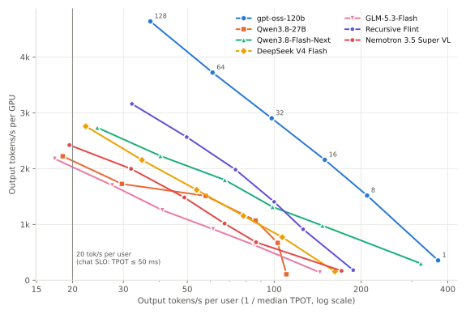

# IggyBench

Open-weight LLMs served with vLLM on one NVIDIA DGX Station GB300, measured per use case: how many people one
machine can serve under a latency target, how good the answers are, and what a million tokens costs.
Measured on 20–22 October 2026.

I had the machine for three days. In that window I ran seven language models (eight configurations) and eleven
specialist models for OCR, speech, embeddings and image generation through 24 tests. The tests range from
single-user speed to ten-minute steady-state load, and from AIME to invoice extraction. Every number in this repository is recomputed from the raw measurements by the scripts
in [`analysis/`](analysis). The full write-up is in [`REPORT.md`](REPORT.md).

## Key results

All throughput figures are output tokens per second on the single GPU. "Users" assumes one request per user per
minute (users = requests/s × 60). Capacity is the highest Poisson arrival rate at which the P95 time to first token
(TTFT) and P95 time per output token (TPOT) both met the target with no failed requests.

| Question | Result | Conditions |
|---|---|---|
| How many chat users? | gpt-oss-120b: 18 req/s (1,080 users). The other four main models: 4–9 req/s (240–540 users) | 1k-token prompt, 512-token answer; P95 TTFT ≤ 2 s, P95 TPOT ≤ 50 ms. The next rate tested failed for every model. |
| How fast for one user? | gpt-oss-120b 381 tok/s; Qwen3.8-27B 112 tok/s, 306 tok/s with the DFlash2 draft model | 512 in, 1,024 out, median TPOT |
| Peak throughput? | gpt-oss-120b 4,640 tok/s at 128 users; Recursive Flint 3,160 (on SGLang); the other main models 2,176–2,760 | 8k in, 1k out, closed loop |
| Long documents? | DeepSeek V4 Flash read a 1,047,552-token prompt in 65 s, and found a planted fact 9 times out of 9 at 128k, 512k and 1M tokens | 1 user |
| Reasoning? | AIME 2025 + 2026: 83–87 % for gpt-oss, DeepSeek, Qwen3.8-Flash-Next and Flint at a 32k-token budget. Qwen3.8-27B rises from 71 % to 92 % with 64k | 60 problems, 2 attempts each; truncated answers count as wrong |
| Degraded invoice scans? | Qwen3.8-27B, Qwen3.8-Flash-Next and GLM reading the image: 89–94 % of fields right. OCR (PaddleOCR-VL) + gpt-oss-120b: 82 %, with the net amount right in 65 % of reads against 100 % for Qwen3.8-27B | 30 synthetic scans, 8 fields each, one request at a time |
| Speech? | Whisper large-v3: 4.1 % word error rate across 7 languages at 468× real time; Voxtral Mini 3B: 4.4 % at 823× | FLEURS, 420 clips, 32 concurrent |
| Cost? | €0.18 (gpt-oss) to €0.82 (DeepSeek) per million output tokens | 24/7 at chat capacity, €140,000 machine over 3 years, €0.15/kWh; electricity is 2–3 % of it |

<picture>
  <source media="(prefers-color-scheme: dark)" srcset="figures/fig01-frontier-dark.svg">
  
</picture>

**Figure 1.** Throughput–interactivity trade-off with 8k-token prompts and 1k-token answers (test T12). Each point
is one concurrency level (1, 8, 16, 32, 64, 128 users, right to left); the numbers next to gpt-oss-120b's points
are those user counts. The vertical line
is the 20 tok/s per user that the chat target implies. One run per point.
Data: [`results/perf_frontier_t12.csv`](results/perf_frontier_t12.csv).

On GSM8K, the hard e-mail set and the clean invoices, the five main models are within 4 points of each other.
Chat capacity, by contrast, differs by a factor of 4.5 between them. AIME, function calling and degraded scans do
separate the models, and in different orders, so the choice of model follows the use case. With one model loaded,
a single GPU of this class served between a few hundred and about a thousand chat users.

## System

| Component | Value |
|---|---|
| Machine | NVIDIA DGX Station GB300 (ASUS ExpertCenter Pro ET900N G3), a vendor demo unit |
| GPU | 1× GB300 (Blackwell Ultra), 288 GB HBM3e on the datasheet, 252 GB visible, 7.1 TB/s; about 16 GB was held by a vendor service in every test |
| CPU and memory | NVIDIA Grace, 72 Arm Neoverse-V2 cores, 496 GB LPDDR5X, NVLink-C2C to the GPU |
| Power limit | 1,300 W (GPU) |
| Driver | 610.43.02, CUDA 13.0 runtime in the container |
| Serving | vLLM 0.32.0 (`vllm/vllm-openai:v0.32.0`, PyTorch 2.13) for every model except Recursive Flint (SGLang; vLLM 0.32 does not support it) and Underdog Bark (Transformers) |
| Load generator | `vllm bench serve` for serving tests; stdlib-only Python clients for the task tests ([`bench/`](bench)) |

## Models

| Model | Type | Precision | Tested with |
|---|---|---|---|
| gpt-oss-120b | mixture of experts (MoE), 117B total / 5.1B active | MXFP4 | full battery |
| Qwen3.8-27B | dense 27B, hybrid linear attention, vision | FP8 | full battery |
| Qwen3.8-Flash-Next | MoE, 125B / 6B active, plus a 51B n-gram lookup table kept in CPU memory; multi-token prediction (MTP) | FP8 | full battery |
| DeepSeek V4 Flash 0731 | MoE, 284B / 13B active, sparse attention, 1M context | FP8 | full battery |
| GLM-5.3-Flash | MoE, 320B / 18B active, hybrid linear attention | NVFP4 | full battery |
| Qwen3.8-27B + DFlash2 | the dense model with a small draft model that proposes 7 tokens per step for speculative decoding | FP8 | reduced battery, coarse rate grid |
| Recursive Flint | MoE, 40B / 2.5B active | BF16 | reduced battery, coarse grid, SGLang |
| Nemotron 3.5 Super VL | MoE, 120B / 12B active, Mamba-2 hybrid, vision, MTP | NVFP4 | reduced battery, coarse grid |

Specialists: PaddleOCR-VL-1.6, Liquid d1-3B and Laya (classifiers that pick a label without generating text), Qwen3-Embedding-8B and
Qwen3-Reranker-8B, Qwen-Image, and five speech models (Whisper large-v3, Voxtral Mini 3B, Qwen3-ASR 1.7B,
Granite 4.0 1B Speech, Underdog Bark 3.0 Pro). Exact checkpoints and server flags: [`docs/models.md`](docs/models.md)
and [`bench/configs/`](bench/configs).

## What was measured

[`docs/tests.md`](docs/tests.md) describes the 24 tests and [`docs/metrics.md`](docs/metrics.md) defines every
metric. In short:

- Serving: single-user speed, prompt reading from 1k to 1M tokens, closed-loop concurrency sweeps, open-loop
  Poisson arrivals at increasing rates (the capacity test), a mixed department load, bursty arrivals, a
  ten-minute steady-state run, and three repeats of two points.
- Use cases: coding-agent sessions growing from 48k to about 100k tokens of context, tool-using agents,
  invoice extraction (vision model against OCR + LLM), e-mail routing, RAG retrieval, image generation, speech
  transcription and needle-in-a-haystack retrieval up to 1M tokens.
- Answer quality: GSM8K, MATH-500, AIME 2025 and 2026, and BFCL v3, with Wilson 95 % intervals and
  Holm-corrected pairwise tests.
- Power and cost: GPU-module power sampled every second, joules per token, and euros per million tokens under
  stated assumptions ([`docs/cost-model.md`](docs/cost-model.md)).

## Which model for which job

These are the choices I would make from this data, for one GPU running one interactive model. Each row points to
the evidence in the report.

| Use case | Choice | What one machine gave | Watch out for |
|---|---|---|---|
| Internal chat for many people | gpt-oss-120b | 1,080 users (1,200 failed) | Last or close to last of the five on most quality tests ([§5.2](REPORT.md#52-answer-quality)) |
| Few users, hard reasoning | Qwen3.8-27B + DFlash2 | 306 tok/s per user, AIME 90 % at 64k | Chat capacity fell from 8–12 to 4–8 req/s ([§5.7](REPORT.md#57-configuration-choices)) |
| Coding agents | DeepSeek V4 Flash | 80 sessions met the target; 96 did not | Only model here configured past 262k context |
| Long contracts and case files | DeepSeek V4 Flash | 1M-token prompt read in 65 s | Needle test is literal retrieval, not reasoning over the text |
| Invoices and scans | Qwen3.8-27B with vision | 1,007 clean pages/min; 93 % of fields on bad scans | GLM matches it on fields at a quarter of the clean-page speed |
| E-mail routing | DeepSeek V4 Flash or Nemotron 3.5 | 100 % and 99.6 % on 240 hard e-mails, 52–56 e-mails/s | Synthetic corpus; Liquid d1-3B answers in 29 ms but drops to 86 % |
| Transcription | Voxtral Mini 3B | ≈ 800 hours of audio per hour, 0.3 points behind Whisper's word error rate | Whisper large-v3 for Catalan (4.8 % against 9.1 %) |

## Limitations

- One machine, one engine version, one three-day window. Most points were measured once for 90 s. Three repeats
  of two points varied by 0.2–1.4 % in throughput and up to 3.3 % in P95 latency (coefficient of variation), so I
  do not interpret differences under 3 %.
- Capacity is an interval between two tested rates, not a point. The three models added on the last day were run on
  a coarser rate grid and a reduced test set.
- The capacity tests use random-token prompts. With real ShareGPT conversations, DeepSeek V4 Flash's median TPOT
  rose 37–195 %, so its chat capacity is probably optimistic.
- AIME was run at 32k tokens for some models and 64k for others. Comparisons across budgets are marked.
- The invoice, e-mail and agent tasks are synthetic, with known answers. BFCL uses a simplified checker. They rank
  models against each other; they are not comparable with official leaderboards.
- Power is the GPU module's, read every second, not wall power.
- Costs are a model with stated inputs (machine price, three-year amortization, full utilization), not a quote.

The complete list, with what each limitation does to the conclusions, is in
[§6 of the report](REPORT.md#6-threats-to-validity).

## Reproduce the analysis

The raw measurements (83 MB compressed) are attached to the
[`v1.0` release](../../releases/tag/v1.0) as `iggybench-raw-v1.tar.gz`. Its layout is described in
[`docs/data.md`](docs/data.md).

```bash
python -m venv .venv && . .venv/bin/activate
pip install -r requirements.txt
mkdir raw && tar xzf iggybench-raw-v1.tar.gz -C raw --strip-components=1
python analysis/point_stats.py     # per-point statistics      -> results/points.csv
python analysis/performance.py     # serving, capacity, cost    -> results/perf_*.csv
python analysis/quality.py         # answer quality             -> results/quality_*.csv
python analysis/config.py          # configuration experiments  -> results/config_*.csv
python analysis/figures.py         # figures/*.svg, *.png
```

The tables in `results/` are committed, so the figures and the report can be checked without downloading anything.

## Run the benchmark

The harness in [`bench/`](bench) expects a Linux server with an NVIDIA GPU, Docker and the vLLM image. `run.sh`
starts a model from its config, waits for it, runs the selected tests and stops it:

```bash
cd bench
./prepare_data.sh
./download_models.sh configs/gptoss120b.env
./run.sh configs/gptoss120b.env T1 T2 T4 T12 T13
```

Paths default to `~/iggybench` and can be changed in [`bench/common.sh`](bench/common.sh). The Hugging Face ids of
GLM-5.3-Flash, DeepSeek V4 Flash, Qwen3.8-Flash-Next and the batch-1 Qwen3.8-27B variants were not recorded during
the run; their configs say so and `download_models.sh` skips them.

[`docs/runs.md`](docs/runs.md) lists what was run in each batch, and in what order.

## Repository layout

```
README.md, REPORT.md   this page and the full report
analysis/              scripts that turn raw data into results/ and figures/
bench/                 the test harness that ran on the server, with one config per model
results/               CSV tables behind every number and figure (committed)
figures/               SVG (light and dark) and PNG
docs/                  tests, metrics, models, cost model, data layout, runs, lessons learned
```

## Disclosure

I ran these tests as part of my job at a systems integrator, on a demo unit booked from the vendor for three days.
Neither the vendor nor NVIDIA saw or reviewed the results. Parts of the analysis code were written with an AI coding
assistant; every number was then recomputed from the raw files, and the checks are in the scripts.

## Citation and license

Code is MIT ([`LICENSE`](LICENSE)). Data, tables and figures are CC BY 4.0 ([`LICENSE-DATA`](LICENSE-DATA)). To cite
this work, use [`CITATION.cff`](CITATION.cff) or the "Cite this repository" button.
