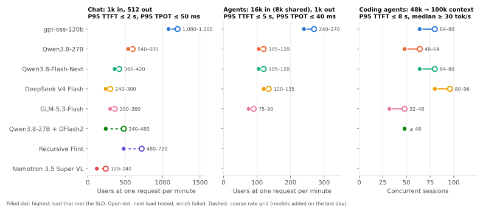
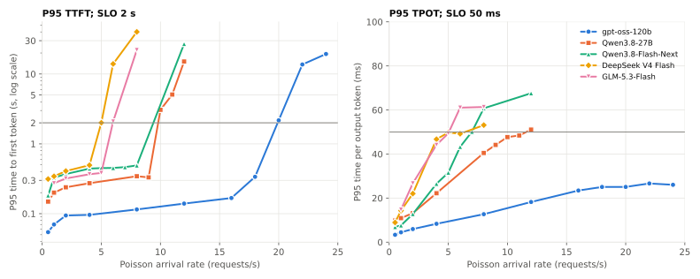
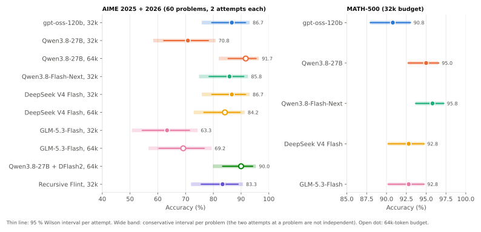
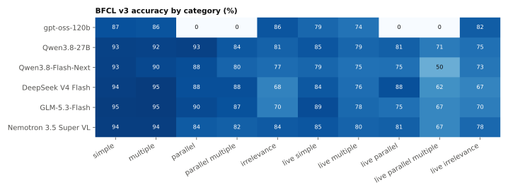
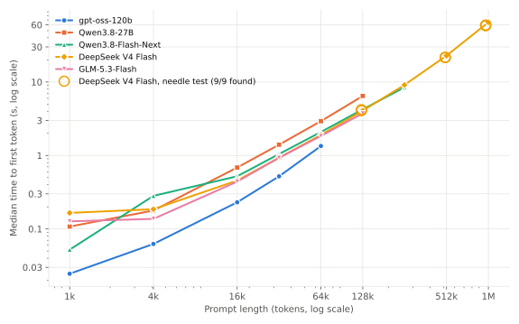
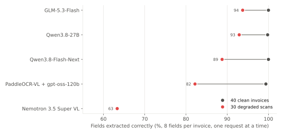
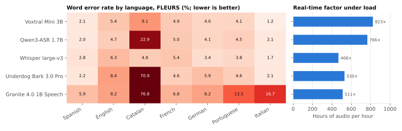
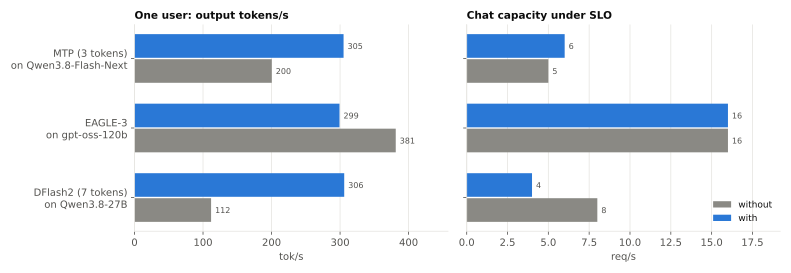
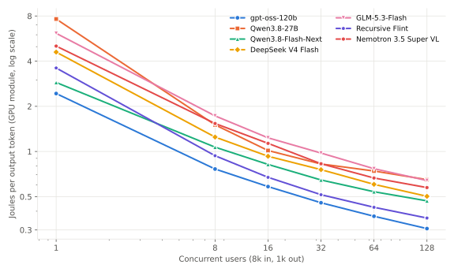

# Serving open-weight LLMs on one NVIDIA GB300: capacity, quality, energy and cost by use case

Ignacio Montero Gil · technical report for IggyBench v1.0 · October 2026

## Abstract

I measured how far one NVIDIA DGX Station GB300 goes as a shared LLM server for a company. Over a three-day booking
I served seven open-weight language models and eleven specialist models with vLLM 0.32 and ran 24 tests, from
single-user speed to ten-minute steady-state load, and from AIME to invoice extraction. Under a chat target of
P95 time to first token ≤ 2 s and P95 time per output token ≤ 50 ms, the GPU served 4–18 requests per second
with the five main models (240–1,080 users at one request per minute), while those five models stayed within
4 points of each other on GSM8K, hard e-mail routing and clean invoices. The main caveats are that each point was
measured once on one machine (three repeats varied by 0.2–1.4 % in throughput), that capacity was measured with
random-token prompts, and that the three models added on the last day ran on a coarser grid.

## 1. Introduction

A company that wants to keep its documents off third-party APIs can buy a single high-end GPU workstation and
serve an open-weight model to its staff. Whether that is a sensible purchase depends on four numbers that vendor
datasheets do not give: how many people one model can serve with acceptable latency, how good the answers are on
the company's tasks, how much energy it draws, and what a million tokens costs once the machine is paid for.

Public benchmarks answer parts of this. MLPerf Inference [1] and InferenceX [3] report serving throughput under
latency limits on data-centre systems. Leaderboards report answer quality, usually through an API and without
saying what serving it took. Community runs on workstations [12] report peak throughput at fixed concurrency. None
of them reports capacity under a latency target together with task quality, energy and cost for the same models on
the same machine and configuration.

This report does that for one machine and the open-weight models available in October 2026. It contributes:

- capacity under a chat, an agent and a coding-session target for eight model configurations, with the failing
  rate reported next to the passing one (§5.1);
- task quality on reasoning, function calling, agents, e-mail routing, invoice extraction and transcription, with
  intervals and corrected pairwise tests (§5.2–§5.6);
- the effect of speculative decoding, model copies and GPU sharing on both per-user speed and capacity (§5.7);
- energy per token from measured power and a cost model with stated inputs (§5.8);
- every raw measurement, the harness that produced it and the scripts that turn it into each table and figure.

## 2. Metrics and service targets

All latencies are measured at the client, on the same machine, and include queueing. The full definitions are in
[docs/metrics.md](docs/metrics.md); the ones the results depend on are:

- TTFT (time to first token) and **TPOT** (time per output token after the first), per request, from
  `vllm bench serve`. One user's speed is 1,000 / median TPOT in ms, in tokens per second.
- Capacity is the highest Poisson arrival rate at which the P95 TTFT and P95 TPOT met the target and no request
  failed. It is reported as an interval to the next tested rate, which failed. "Users" is that rate × 60, assuming
  one request per user per minute.

| Profile | Request shape | P95 TTFT | P95 TPOT |
|---|---|---|---|
| Chat | 1,024 prompt tokens, 512 output | ≤ 2 s | ≤ 50 ms (≥ 20 tok/s per user) |
| Agents | 8,192 prompt + 8,192 shared prefix, 1,024 output | ≤ 5 s | ≤ 40 ms |
| RAG (department mix only) | 8,192 prompt, 256 output | ≤ 5 s | ≤ 50 ms |
| Coding sessions | 48k growing to ~100k context, 300 output per turn | ≤ 8 s on follow-up turns | median decode ≥ 30 tok/s |

The chat target follows common practice for interactive use; MLPerf's conversational scenario uses P99 ≤ 2 s and
≤ 200 ms [1]. Re-checked against MLPerf's P99 limits, chat capacity came out the same or higher for every model except DeepSeek V4
Flash, whose P99 TTFT passed 2 s at 4 req/s (2 req/s under MLPerf's rule, against 4 under mine);
`perf_capacity.csv`, column `mlperf_conv_max_req_s`.

A few terms recur. A mixture-of-experts (MoE) model runs only part of its weights per token (the "active"
parameters). Multi-token prediction (MTP) and draft models (EAGLE-3, DFlash2) are forms of speculative decoding: a
cheap predictor proposes several tokens and the model verifies them in one step. MIG and MPS are NVIDIA's two ways
to partition a GPU between processes; neither was used. Holm's method adjusts p-values for the number of
comparisons made.

## 3. Experimental setup

### 3.1 Hardware and software

| Component | Value |
|---|---|
| Machine | NVIDIA DGX Station GB300, built by ASUS (ExpertCenter Pro ET900N G3); a vendor demo unit |
| GPU | 1× GB300 (Blackwell Ultra), 288 GB HBM3e per the datasheet, 252 GB visible, 7.1 TB/s, 1,300 W power limit |
| CPU and memory | Grace, 72 Arm Neoverse-V2 cores, 496 GB LPDDR5X, NVLink-C2C between CPU and GPU |
| Driver | 610.43.02 |
| Serving | vLLM 0.32.0 (`vllm/vllm-openai:v0.32.0`; CUDA 13.0 runtime, PyTorch 2.13, transformers 5.19); SGLang for Recursive Flint, which vLLM 0.32 does not support; Transformers for Underdog Bark |
| Network | ConnectX-8, 2 × 400 Gb/s, unused |

A vendor service occupied about 16 GB of GPU memory throughout. Every model ran with that memory unavailable.

### 3.2 Models

| Model | Architecture | Precision | Main settings | Test set |
|---|---|---|---|---|
| gpt-oss-120b | MoE, 117B / 5.1B active | MXFP4 | 85 % memory, 256 sequences, 131k context | full |
| Qwen3.8-27B | dense, linear + full attention, vision | FP8 | 85 %, 256 sequences, 262k context | full |
| Qwen3.8-Flash-Next | MoE, 125B / 6B active, 51B n-gram table in Grace RAM | FP8 | 88 %, MTP 3 tokens, 256 sequences | full |
| DeepSeek V4 Flash 0731 | MoE, 284B / 13B active, sparse attention | FP8 | 88 %, 128 sequences, 1M context | full |
| GLM-5.3-Flash | MoE, 320B / 18B active, linear + sparse attention | NVFP4 | 88 %, no MTP | full |
| Qwen3.8-27B + DFlash2 | dense + 7-token draft model | FP8 | as Qwen3.8-27B | reduced |
| Recursive Flint | MoE, 40B / 2.5B active | BF16 | SGLang, 80 % | reduced |
| Nemotron 3.5 Super VL | MoE, 120B / 12B active, Mamba-2 hybrid, vision | NVFP4 | 85 %, MTP 3 tokens | reduced |

Specialists: PaddleOCR-VL-1.6 (OCR), Liquid d1-3B and Laya (classification without generation), Qwen3-Embedding-8B
and Qwen3-Reranker-8B (retrieval), Qwen-Image (image generation), and Whisper large-v3, Voxtral Mini 3B, Qwen3-ASR
1.7B, Granite 4.0 1B Speech and Underdog Bark 3.0 Pro (speech). [docs/models.md](docs/models.md) has sizes,
licences, repositories and the models that were considered and dropped.

Each model used its published vLLM recipe where one existed, or the most stable configuration found in the first
batch. I did not tune batch sizes or scheduler settings per model beyond that; §6 lists what this leaves open.

### 3.3 Harness and schedule

`bench/suite.sh` drives `vllm bench serve` (vLLM [2]) for the serving tests and saves per-request detail, one-second GPU
telemetry (`nvidia-smi`), vLLM's metrics every 2 s, the server command and the full server log. Python clients
using only the standard library run the task tests, because the server had no package index. A queue script ran
model batteries back to back with an end time and an automatic backup.

| Block | Dates (UTC) | Content |
|---|---|---|
| Batch 1 | 20–21 Oct | First battery: precision variants of Qwen3.8-27B, MTP on GLM, and gpt-oss-120b's department test; otherwise superseded by batch 2 |
| Batch 2 | 21–22 Oct | Main battery of the five main models, specialists and configuration variants |
| Queue 4 | 22 Oct, morning | Finer capacity grid for gpt-oss-120b, coding sessions above 64, repeats, AIME at 64k, corrected degraded invoices, idle power |
| Queues 5–9 | 22 Oct, afternoon | DFlash2, Flint, Nemotron, speech, needle in a haystack |

[docs/runs.md](docs/runs.md) lists every run, with its tests and settings.

## 4. Methodology

### 4.1 Workloads

The serving tests follow the recommendations of [6], [4] and [1]: absolute latencies rather than normalised
ones, full distributions, capacity under a latency target rather than throughput at saturation, open-loop
arrivals, and a steady-state run.

- Closed loop (T3, T12): a fixed number of users, each sending the next request when the previous one ends.
  This gives throughput at a given concurrency and the throughput–interactivity curve of Figure 1, but it
  understates latency under load, because a slow server slows its own arrivals.
- Open loop (T4, T4F, T9, T18, T19): Poisson arrivals at a fixed rate for 90 s per rate (120 s per department
  size, 600 s for T19). This is the capacity test. T4 used a coarse grid (0.5, 1, 2, 4, 8, 12, 16 req/s); T4F
  added the intermediate rates between the last pass and the first failure for the five main models, and kept
  going up for gpt-oss-120b, which passed every T4 rate.
- Prompts are random tokens of fixed length, as in InferenceX and the community runs, so results compare across
  machines. T15 repeats part of the sweep with real text to measure the bias that introduces.
- Warm-up requests before each battery are not measured. Seeds are fixed and recorded.
- Early stopping skips the harder points of a sweep once a point exceeds 3× the target or loses more than 5 % of
  requests. The failing point is still reported.

### 4.2 Statistics

- Proportions get 95 % Wilson intervals. In AIME each problem was attempted twice and the attempts are not
  independent, so I also give a conservative interval with n equal to the number of problems, and count a
  difference as significant only if it holds under that interval.
- Pairwise comparisons use exact McNemar tests on GSM8K, where per-question results exist, and two-proportion z
  tests elsewhere, which are unpaired and therefore conservative. p-values are Holm-corrected over all pairs
  compared within a test.
- Latency percentiles get bootstrap 95 % intervals (1,000 resamples) where per-request data exists.
- Run-to-run variation. Three repeats of chat and of 8k/1k at 64 users on two models (T17) gave a coefficient
  of variation of 0.2–1.4 % for throughput and up to 3.3 % for P95 latency. I treat differences below 3 % as noise.
  In capacity, one step of the grid (1 req/s, or 2 req/s for gpt-oss-120b) is larger than that.

### 4.3 Energy and cost

Power is the GPU module's, read every second with `nvidia-smi` and averaged over each point's window. It excludes
power supplies and fans. Energy per token is mean power × duration / output tokens. The cost per million output
tokens amortizes a €140,000 machine over three years of continuous use and adds electricity at €0.15 per kWh at the
measured power. The inputs, the market prices behind them and an office-hours variant are in
[docs/cost-model.md](docs/cost-model.md).

## 5. Results

### 5.1 Capacity and speed

gpt-oss-120b served the most chat users and was the fastest for one user. DeepSeek V4 Flash held the most coding
sessions. The capacity of every model ended in a sharp step.

<picture>
  <source media="(prefers-color-scheme: dark)" srcset="figures/fig02-capacity-dark.svg">
  
</picture>

**Figure 2.** Capacity under each target. Filled dot: highest tested load that met it; open dot: next load, which
failed. Dashed: coarse rate grid. One run per point.
Data: [`perf_capacity.csv`](results/perf_capacity.csv), [`perf_coding_capacity.csv`](results/perf_coding_capacity.csv).

| Model | One user, tok/s | TTFT, one user (ms) | Chat, req/s | Agents, req/s | Coding sessions | Tok/s per GPU, 128 users, 8k/1k |
|---|---|---|---|---|---|---|
| gpt-oss-120b | 381 | 22 | 18–20 | 4–4.5 | 64–80 | 4,640 |
| Qwen3.8-27B | 112 | 47 | 9–10 | 1.75–2 | 48–64 | 2,222 |
| Qwen3.8-Flash-Next | 305 | 56 | 6–7 | 1.75–2 | 64–80 | 2,736 |
| DeepSeek V4 Flash | 167 | 174 | 4–5 | 2–2.25 | 80–96 | 2,760 |
| GLM-5.3-Flash | 145 | 46 | 5–6 | 1.25–1.5 | 32–48 | 2,176 |
| Qwen3.8-27B + DFlash2 † | 306 | 66 | 4–8 | – | ≥ 48 (most tested) | – |
| Recursive Flint † (SGLang) | 190 | 82 | 8–12 | – | – | 3,160 |
| Nemotron 3.5 Super VL † | 206 | 53 | 2–4 | – | – | 2,423 |

*Chat and agents: last passing and first failing Poisson rate. Multiply by 60 for users at one request per minute.
† Coarse grid (0.5, 1, 2, 4, 8, 12 req/s) and reduced test set; on the same grid Qwen3.8-27B without the draft
model passes 8 req/s and gpt-oss-120b passes 16. Data: [`perf_single_user.csv`](results/perf_single_user.csv),
[`perf_capacity.csv`](results/perf_capacity.csv), [`perf_frontier_summary.csv`](results/perf_frontier_summary.csv).*

<picture>
  <source media="(prefers-color-scheme: dark)" srcset="figures/fig03-chat-latency-dark.svg">
  
</picture>

**Figure 3.** P95 TTFT (log scale) and P95 TPOT against arrival rate, chat profile, five main models; horizontal
lines are the targets. Data: [`perf_capacity_points.csv`](results/perf_capacity_points.csv).

- Capacity ends in a single step. For gpt-oss-120b, Qwen3.8-27B and DeepSeek V4 Flash, P95 TTFT stays under 0.5 s and then
  passes 2 s within one rate step, as the server's sequence limit fills and requests start to queue (Figure 3).
  Qwen3.8-Flash-Next fails on TPOT alone (P95 50.1 ms at 7 req/s) before a queue forms; GLM-5.3-Flash fails on both
  (P95 TTFT 2.1 s and TPOT 61 ms at 6 req/s). There is little warning, so I would plan for 70–80 % of the measured capacity, about 750–850 users with
  gpt-oss-120b.
- Ten minutes at a fixed rate (T19) confirmed gpt-oss-120b at 16 req/s (2 failed requests
  of 9,600), Qwen3.8-27B at 8 req/s (2 of 4,800), and Qwen3.8-Flash-Next and DeepSeek V4 Flash at 4 req/s (none
  failed). Those rates were set from the coarse T4 grid before the fine grid ran, so they sit one to two fine steps
  below the capacity in the table; T19 confirms stability at those rates, not at the capacity itself.
- Capacities measured one profile at a time do not add up. In the department test, with chat, RAG and agent traffic at once (T9),
  Qwen3.8-27B met all three targets for 50 people and failed at 100, against 540 chat-only users. It reads prompts
  slowest of the five (about 23,000 tok/s), and the long RAG and agent prompts delay the chat requests.
  gpt-oss-120b passed the largest department tested, 400 people (measured in batch 1 with the same configuration); DeepSeek V4 Flash and Qwen3.8-Flash-Next passed 200
  and failed at 400. GLM-5.3-Flash was not run on this test.
- Coding sessions depend on the prefix cache. Up to 64 sessions, 92–97 % of each turn's prompt came from the
  cache for every model. Above that, DeepSeek V4 Flash, with 7.2 million tokens of KV cache, kept 96 % and degraded
  gradually; gpt-oss-120b and Qwen3.8-Flash-Next lost the cache abruptly (35 % and 42 % at 96 sessions) and their
  TTFT jumped to 25–130 s.
- At 128 users nobody meets the chat target. In the 8k/1k sweep, P95 TTFT at 128 users was 8.6 s for
  gpt-oss-120b and 16–32 s for the rest. That test measures throughput, not service.

[Figure 1](README.md#key-results) in the README shows the throughput–interactivity curve from the same sweep. At
50 tok/s per user, interpolated between measured points, gpt-oss-120b delivered 4,151 tok/s per GPU and the other
models 1,105–2,561.

### 5.2 Answer quality

On GSM8K, hard e-mails and clean invoices the five main models are within 4 points. AIME, function calling and
degraded scans separate them, and not in the same order. gpt-oss-120b is the lowest of the five on eight of the eleven
measures below.

| Measure (items) | gpt-oss-120b | DeepSeek V4 Flash | Qwen3.8-Flash-Next | Qwen3.8-27B | GLM-5.3-Flash | Nemotron 3.5 |
|---|---|---|---|---|---|---|
| GSM8K, direct answer (1,319) | 96.1 | **97.1** | 97.0 | 96.7 | 95.5 | – |
| MATH-500, 32k budget (500) | 90.8 | 92.8 | **95.8** | 95.0 | 92.8 | – |
| AIME 2025 + 2026, 32k budget (120) | **86.7** | **86.7** | 85.8 | 70.8 | 63.3 | – |
| BFCL simple (400) | 87.2 | 94.0 | 93.2 | 92.8 | **94.8** | 94.2 |
| BFCL multiple (200) | 86.0 | **95.0** | 90.5 | 92.5 | **95.0** | 94.5 |
| BFCL parallel (200) | 0.0 | 88.0 | 88.5 | **93.0** | 89.5 | 83.5 |
| BFCL irrelevance, both sets (pooled) | **84.1** | 67.8 | 74.7 | 78.1 | 69.9 | 81.0 |
| BFCL live multiple (1,052) | 73.9 | 76.2 | 74.8 | 79.3 | 78.0 | **80.4** |
| Agents, 8 tasks × 16 runs at 64 concurrent | 87.5 | **100** | **100** | **100** | 99.2 | 87.5 |
| Hard e-mails, category and urgency (240) | 96.2 | **100** | 97.9 | 97.9 | **100** | 99.6 |
| Degraded invoices, fields (30 × 8) | 82.2 ‡ | – | 88.8 | 92.9 | **93.8** | 63.3 |

*Accuracy in %. Bold: best in the row. ‡ Through PaddleOCR-VL, since gpt-oss-120b has no vision. Nemotron ran a
reduced set; Recursive Flint ran AIME (83.3 % at 32k), agents and hard e-mails only. On the hard e-mails,
gpt-oss-120b scored 95.0 % with the prompt used for the d1-3B comparison (§5.4). Data: `results/quality_*.csv`.*

<picture>
  <source media="(prefers-color-scheme: dark)" srcset="figures/fig06-reasoning-dark.svg">
  
</picture>

**Figure 4.** AIME 2025 + 2026 and MATH-500 accuracy. Thin line: 95 % Wilson interval per attempt; wide band:
conservative interval per problem. Open dot: 64k-token budget. Data: [`quality_reasoning.csv`](results/quality_reasoning.csv).

- At 32k tokens, 127 of the 128 failures of the five main
  models were answers cut off at the limit; answers that finished were right 99.8 % of the time. With 64k,
  Qwen3.8-27B rose from 70.8 % to 91.7 % and GLM-5.3-Flash from 63.3 % to 69.2 %. DeepSeek V4 Flash did not improve
  (84.2 %; 18 of 120 answers still truncated). gpt-oss-120b and Qwen3.8-Flash-Next were not re-run at 64k, so the
  ranking mixes budgets. Across all ten model and budget combinations (45 pairs, Holm-corrected, conservative per
  problem), only GLM-5.3-Flash at 32k is significantly below Qwen3.8-27B at 64k, with or without DFlash2.
- DeepSeek V4 Flash reasons with fewer tokens. At 32k it matched gpt-oss-120b on AIME with a median of 3,800–4,700
  completion tokens per attempt, against 10,000–11,500 for gpt-oss-120b.
- GSM8K and MATH-500 are nearly saturated. After Holm correction, one difference remains in each: DeepSeek V4
  Flash over GLM-5.3-Flash on GSM8K (+1.6 points, McNemar p = 0.046) and Qwen3.8-Flash-Next over gpt-oss-120b on
  MATH-500 (+5.0 points, p = 0.016).
- Function calling shows two profiles. DeepSeek V4 Flash and GLM-5.3-Flash call the right function more often but
  also call one when none applies: they abstained correctly in 68–70 % of those cases, against 84 % for
  gpt-oss-120b. The second number matters most for agents whose calls have side effects, such as sending e-mails or
  opening tickets.
- gpt-oss-120b's 0 % on parallel calls is the tool-call parser. vLLM 0.32's parser for this model emits one call
  per turn. It only matters when an agent needs several calls in one turn.
- The agent test is saturated. Eight tasks at temperature 0 give an effective sample of eight; one task is
  12.5 points. It measures throughput (365 tasks per minute for gpt-oss-120b at 64 agents, 113–210 for the others)
  more than quality. gpt-oss-120b fails one task every time because the grader requires a specific Spanish word.

Of the eleven measures in the table, gpt-oss-120b is lowest of the five main models on eight (on degraded
invoices, lowest of the four with a value), fourth on GSM8K, and first on two: AIME at 32k, tied with DeepSeek V4
Flash, and abstaining when no function applies. Its gap to the next model up is under 7 points on every measure
except the agent test, where one task out of eight is 12.5 points. Against the best model the gap reaches 9 points
on BFCL multiple (86.0 against 95.0). The three largest gaps have the causes given above: the tool-call parser
(parallel calls), the agent grader, and reading invoices through OCR because the model has no vision.

<picture>
  <source media="(prefers-color-scheme: dark)" srcset="figures/fig07-bfcl-dark.svg">
  
</picture>

**Figure 5.** BFCL v3 accuracy by category, simplified AST checker. Data: [`quality_bfcl.csv`](results/quality_bfcl.csv).

### 5.3 Long prompts and retrieval

The models read 20,000–37,000 prompt tokens per second at 16k–128k, and gpt-oss-120b about 71,000 at 16k. Only
DeepSeek V4 Flash was configured past 262k, and it found a planted fact in a one-million-token prompt nine times
out of nine.

<picture>
  <source media="(prefers-color-scheme: dark)" srcset="figures/fig04-long-context-dark.svg">
  
</picture>

**Figure 6.** Median TTFT against prompt length, one user (T2, T5). Circles: the needle-in-a-haystack runs of
DeepSeek V4 Flash (T24). One request per length above 128k. Data: [`perf_prompt_reading.csv`](results/perf_prompt_reading.csv),
[`quality_needle.csv`](results/quality_needle.csv).

| Model | Read tok/s at 16k | at 64k | at 128k | Longest prompt measured |
|---|---|---|---|---|
| gpt-oss-120b | 71,078 | 48,772 | not measured (131k context) | 64k in 1.3 s |
| GLM-5.3-Flash | 37,178 | 35,623 | 34,997 | 128k |
| DeepSeek V4 Flash | 35,935 | 34,393 | 32,098 | 1,047,552 tokens in 65 s |
| Qwen3.8-Flash-Next | 31,453 | 31,386 | 30,897 | 261k in 8.5 s |
| Qwen3.8-27B | 23,928 | 22,360 | 20,295 | 128k |

- GLM-5.3-Flash, Qwen3.8-Flash-Next and DeepSeek V4 Flash read at nearly the same rate from 16k to 128k
  (2–11 % slower). gpt-oss-120b is the fastest but loses 31 % from 16k to 64k. The dense Qwen3.8-27B is the slowest.
- Several long documents at once share the GPU. With four 128k prompts at the same time, P95 TTFT was 14–15 s
  for DeepSeek V4 Flash and Qwen3.8-Flash-Next.
- In the needle-in-a-haystack test (T24), at 128k, 512k and 1M tokens, with the fact at 10, 50 and 90 % depth, DeepSeek V4
  Flash returned the right code 9 times out of 9, in 4.1 s, 21.6 s and about 59 s. Eight times more text took about
  14 times longer; purely quadratic attention would take 64 times longer. The test checks literal retrieval, not
  reasoning over the whole document.
- Qwen3-Embedding-8B indexed ~540-token chunks at 192–197 chunks per second at full load
  (one million chunks in about 85 minutes) and answered a single query in 15 ms. Qwen3-Reranker-8B reranked 50
  documents in 104 ms. The only quality check was a sanity test on GSM8K question → solution pairs (recall@1 97 %,
  recall@5 100 %), which does not measure retrieval on real documents.
- Qwen-Image produced 5.2–6.6 images per minute at 1024² with 50 steps (batches of 1 to 8), with
  58–86 GiB of peak memory. Image quality was not measured.

### 5.4 E-mail classification

On the hard synthetic set the language models beat the small classifiers by 10 points or more. DeepSeek V4 Flash,
GLM-5.3-Flash and Nemotron 3.5 routed 99.6–100 % of 240 hard e-mails; the 3B classifier d1-3B routed simple e-mails
in 29 ms.

| System | Normal e-mails (300), category | Hard e-mails (240), category and urgency [95 % CI] | Median latency | E-mails/s |
|---|---|---|---|---|
| Nemotron 3.5 Super VL | – | 99.6 % [97.7–99.9] | 453 ms | 56.3 |
| DeepSeek V4 Flash | – | 100 % [98.4–100] | 475 ms | 51.5 |
| GLM-5.3-Flash | – | 100 % [98.4–100] | 4,472 ms | 6.1 |
| Qwen3.8-Flash-Next | – | 97.9 % [95.2–99.1] | 737 ms | 40.5 |
| Qwen3.8-27B | – | 97.9 % [95.2–99.1] | 857 ms | 35.2 |
| gpt-oss-120b | 100 % | 96.2 % [93.0–98.0] | 684 ms | 39.0 |
| Recursive Flint (SGLang) | – | 88.8 % [84.1–92.2] | 3,954 ms | 6.0 |
| Liquid d1-3B | 94.0 % | 85.8 % [80.9–89.7] | 29 ms | 35.0 |
| Laya (322M) | 68.3 % | 28.8 % [23.4–34.8] | 24 ms | 601 |

*Hard set: several topics with a priority rule, phishing that mentions invoices, pro-forma invoices, quoted
threads, irony, chat style, other languages. LLMs without reasoning, 32 concurrent. d1-3B and Laya pick a label without generating text; latency is one e-mail
at a time, throughput in batches of 128 (d1-3B gains little from batching: 31 e-mails/s one at a time).
Data: [`quality_email_hard.csv`](results/quality_email_hard.csv), [`quality_email_classify.csv`](results/quality_email_classify.csv).*

- The five main LLMs are 10–14 points above d1-3B on the hard set. d1-3B
  gets every urgency right; its errors are categories, where a keyword misleads (phishing about an "overdue
  invoice") or a priority rule decides.
- Two models are slow because they reason. GLM-5.3-Flash did not switch off its reasoning (about 200 output
  tokens per e-mail against 16–18 for the Qwen models) and Flint produced about 250. Both took 4 s or more per
  e-mail.
- gpt-oss-120b's 9 errors fall in one of the 20 templates (an order conditional on stock, read as
  a stock enquiry): one rule, fixable with an example in the prompt. Laya's errors spread over 11 templates.
- The corpus is synthetic, 20 templates × 12 e-mails, so errors are correlated within a template and the
  intervals above are optimistic.

### 5.5 Invoices

With clean invoices every system got 99.4–100 % of fields and speed decided: Qwen3.8-27B read 1,007 pages per
minute. With degraded scans, models that read the image got the amounts right far more often than OCR followed by a
text model.

<picture>
  <source media="(prefers-color-scheme: dark)" srcset="figures/fig08-invoices-dark.svg">
  
</picture>

**Figure 7.** Share of the 8 fields extracted correctly, one request at a time. The vision models read each of the 30
degraded scans once; the OCR pipeline made 40 reads of them. Data:
[`quality_invoices.csv`](results/quality_invoices.csv).

| System, degraded scans (30) | Fields | Perfect invoices | Net amount | Total | Supplier tax ID | Line count |
|---|---|---|---|---|---|---|
| GLM-5.3-Flash, vision | **93.8 %** | **73 %** | 96.7 % | 96.7 % | 83.3 % | **93.3 %** |
| Qwen3.8-27B, vision | 92.9 % | 50 % | **100 %** | **100 %** | **86.7 %** | 70.0 % |
| Qwen3.8-Flash-Next, vision | 88.8 % | 33 % | **100 %** | 96.7 % | 70.0 % | 50.0 % |
| PaddleOCR-VL + gpt-oss-120b | 82.2 % | 35 % | 65.0 % | 75.0 % | 70.0 % | 77.5 % |
| Nemotron 3.5 Super VL, vision | 63.3 % | 0 % | 93.3 % | **100 %** | 20.0 % | 3.3 % |

- What OCR misreads reaches the text model wrong: the net amount was right on every invoice
  with Qwen3.8-27B and in 65 % of reads with OCR + gpt-oss-120b; the total in 100 % against 75 %.
- GLM-5.3-Flash had the most perfect invoices but read 76 pages per minute at 32 concurrent, against 849–951 for the
  Qwen models, because it reasons (about 890 output tokens per invoice against 126 for Qwen3.8-27B).
- Nemotron 3.5 read the amounts well but rarely the supplier's tax ID or the number of lines, and produced no
  perfect invoice, while being the fastest (1,154 pages per minute at 32 concurrent).
- On clean invoices, Qwen3.8-27B with vision reached 1,007 pages per minute at 128 concurrent, Qwen3.8-Flash-Next 739,
  OCR + gpt-oss-120b 488 at 32. Sharing the GPU with gpt-oss-120b, Qwen3.8-27B kept its accuracy but dropped to 179
  pages per minute at 8 concurrent.

### 5.6 Transcription

Whisper large-v3 had the lowest word error rate across 7 languages (4.1 %) and was the only model solid in Catalan.
Voxtral Mini 3B was 0.3 points behind (4.4 %) at 1.8 times Whisper's speed under load (823× against 468× real time).

<picture>
  <source media="(prefers-color-scheme: dark)" srcset="figures/fig09-asr-dark.svg">
  
</picture>

**Figure 8.** WER by language on FLEURS (60 clips per language) and real-time factor at 32 concurrent (Bark:
batches of 16). Data: [`quality_asr.csv`](results/quality_asr.csv).

- In Spanish, Qwen3-ASR (2.0 %) and Voxtral (2.1 %) were best. Without Catalan, Voxtral, Qwen3-ASR and Whisper are
  within 0.3 points of each other (3.6–3.9 %, mean of six languages).
- Voxtral transcribed an hour of audio in about 4.4 s at load. All speech models ran with 30 % of GPU
  memory.
- Underdog Bark 3.0 Pro is published with 4.29 % WER on English; here it had 8.4 %. The normaliser used here is
  simpler than the one behind that figure, so this is not a like-for-like check. Bark ran on Transformers, the others
  on vLLM, and it handled every language except Catalan (70.9 %) although it is published for English.
- Granite 4.0 1B Speech does not handle Catalan (76.8 %) and is weaker in Italian (16.7 %) and Portuguese
  (13.5 %).
- FLEURS is read speech recorded cleanly, with one speaker per clip. Calls and meetings will have higher
  error rates.

### 5.7 Configuration choices

One interactive model per GPU, with all the memory, gave the most capacity. Two copies or a shared GPU cost
38–50 %. Of the speculative methods, MTP paid off, EAGLE-3 did not, and DFlash2 traded capacity for per-user speed.

<picture>
  <source media="(prefers-color-scheme: dark)" srcset="figures/fig10-speculative-dark.svg">
  
</picture>

**Figure 9.** One-user speed and chat capacity with and without speculative decoding. Capacity compares the same
rate grid on both sides. Data: [`config_speculative.csv`](results/config_speculative.csv).

- With the same total memory, two copies of gpt-oss-120b delivered 38–44 % less than one
  instance at 16–256 total users, and each token took 68–84 % longer. Without MPS or MIG the two processes take turns
  on the GPU and each runs half-size batches. Two copies are worth it only when data must be isolated.
- With gpt-oss-120b and Qwen3.8-27B loaded together, gpt-oss-120b's chat capacity fell from
  16 req/s to 8 (failing at 12, where it passed alone), and Qwen3.8-27B's agents stopped meeting their target.
- MTP on Qwen3.8-Flash-Next: +52 % for one user (305 against 200 tok/s) and one more rate step of chat capacity
  (6 against 5 req/s).
- EAGLE-3 [15] on gpt-oss-120b: the draft head's tokens were accepted 8–10 % of the time and each step got more
  expensive: −22 % for one user (299 against 381 tok/s), same chat capacity.
- DFlash2 on Qwen3.8-27B: 2.7× for one user (306 against 112 tok/s) and 522 tok/s per session with four coding
  sessions, the fastest of the study. On the same coarse grid chat capacity fell from 8–12 to 4–8 req/s (failing at
  8 req/s on TPOT, P95 75 ms, where the model without the draft passes). On a batch of AIME problems at 128 concurrent it finished in
  9.2 minutes instead of 17.1, with the same accuracy (90.0 % against 91.7 %, within noise).
- Acceptance depends on the output. DFlash2's draft tokens were accepted 29 % of the time in chat on random
  tokens, 40 % on AIME and 81 % in coding sessions. Nemotron's MTP: 6–16 % on random tokens, 85 % on structured
  output (agents, BFCL). Qwen3.8-Flash-Next's MTP fell from 71 % on random tokens to 42 % on real text with one user.
  Data: [`config_spec_acceptance.csv`](results/config_spec_acceptance.csv).
- DeepSeek V4 Flash with 256 sequences instead of 128: same chat capacity (4 req/s). The queue disappears but each
  token is slower (P95 TPOT 58 ms at 5 req/s), and the KV cache falls from 7.2 to 2.5 million tokens because the
  context is cut to 262k.
- Qwen3.8-Flash-Next with its n-gram table in GPU memory instead of Grace RAM: +4 % for one user (within noise),
  capacity in [4, 8) against 6–7 req/s, and 54 % less KV cache. Keep the table in Grace RAM.

| Configuration | GPU memory reserved | KV cache (tokens) | Max context |
|---|---|---|---|
| Nemotron 3.5 Super VL | 85 % | 10.6 M | 131k |
| DeepSeek V4 Flash | 88 % | 7.2 M | 1M |
| Qwen3.8-Flash-Next, MTP | 88 % | 6.0 M | 262k |
| Qwen3.8-27B | 85 % | 5.8 M | 262k |
| GLM-5.3-Flash | 88 % | 4.3 M | 262k |
| Qwen3.8-27B + DFlash2 | 85 % | 4.1 M | 262k |
| gpt-oss-120b | 85 % | 3.3 M | 131k |
| DeepSeek V4 Flash, 256 sequences | 88 % | 2.5 M | 262k |
| Qwen3.8-Flash-Next, n-gram table in GPU | 88 % | 2.8 M | 262k |
| gpt-oss-120b, two copies | 2 × 42 % | 2 × 0.8 M | 131k |

*From vLLM's start-up log. Data: [`perf_kv_cache.csv`](results/perf_kv_cache.csv).*

### 5.8 The machine: bandwidth, energy and cost

With one user the GB300 used 15–43 % of its memory bandwidth; gpt-oss-120b's throughput per GPU rose 13× from 1 to
128 users (355 to 4,640 tok/s). Energy per token fell 6–12× over the same range. Amortization was 96–98 % of the cost.

#### Bandwidth

Generating a token reads the active weights from memory once, so at batch size one the speed is
bounded by bandwidth. Bytes per token ≈ active parameters × bytes per parameter gives an estimate (±20 %):

| Model | GB read per token | One user, tok/s | Bandwidth used | Share of 7.1 TB/s |
|---|---|---|---|---|
| Qwen3.8-27B (dense, FP8) | 27 | 112 | 3.0 TB/s | 43 % |
| DeepSeek V4 Flash (13B active, FP8) | 13 | 167 | 2.2 TB/s | 31 % |
| GLM-5.3-Flash (18B active, NVFP4) | 10 | 145 | 1.5 TB/s | 21 % |
| gpt-oss-120b (5.1B active, MXFP4) | 2.9 | 381 | 1.1 TB/s | 15 % |

*Data: [`perf_bandwidth.csv`](results/perf_bandwidth.csv). Models with speculative decoding are left out because
they verify several tokens per weight read.*

The smaller the active parameter count, the less of the bandwidth one user uses: fixed per-step costs (kernel
launches, expert routing, synchronisation) dominate. A DGX Spark has 273 GB/s according to NVIDIA's datasheet, 26×
less than this GPU. For gpt-oss-120b at one user, the bandwidth bound on a Spark is about 94 tok/s, so the GB300's
381 tok/s is about 4× that bound, not 26×. DeepSeek V4 Flash and GLM-5.3-Flash do not fit in a Spark's 128 GB.

#### A rule of thumb for capacity

By Little's law, the chat capacity is about the number of sequences the server
admits at once divided by the time a 512-token answer takes when the server is full (TTFT + 511 × TPOT). With the
medians at the first failing rate, this predicts 20.0 req/s for gpt-oss-120b (measured 18–20) and 5.3 for DeepSeek
V4 Flash (4–5), both limited by their sequence count. It overestimates Qwen3.8-27B by about 20 % (12.1 against
9–10), and it does not apply to Qwen3.8-Flash-Next and GLM-5.3-Flash, which hit the TPOT limit before the queue
fills. Data: [`perf_little_law.csv`](results/perf_little_law.csv).

<picture>
  <source media="(prefers-color-scheme: dark)" srcset="figures/fig05-energy-dark.svg">
  
</picture>

**Figure 10.** GPU-module energy per output token, 8k-token prompts and 1k-token answers (T12). Data:
[`perf_frontier_t12.csv`](results/perf_frontier_t12.csv).

#### Energy

Idle, the GPU module drew 339 W. Under load the highest one-point averages were 0.9–1.3 kW (1,301 W for
Qwen3.8-27B with DFlash2 at 12 req/s). Energy per output token fell 6–12× from one user to 128 (gpt-oss-120b: 2.43 J
to 0.31 J). At chat capacity gpt-oss-120b used
0.15 J per output token, the other main models 0.29–0.52 J. These figures exclude the Grace CPU, power supplies and
fans. Data: [`perf_power.csv`](results/perf_power.csv), [`perf_energy_cost.csv`](results/perf_energy_cost.csv).

#### Cost

| Model | Power at chat capacity | J per output token | €/Mtok, 24/7, €140k | 24/7, €90k | Office hours, €140k | API, chat-equivalent $/Mtok |
|---|---|---|---|---|---|---|
| gpt-oss-120b | 1,059 W | 0.15 | **0.18** | **0.12** | **0.71** | 0.21–0.90 |
| Qwen3.8-27B | 1,077 W | 0.29 | 0.36 | 0.23 | 1.46 | 1.33–2.90 |
| Recursive Flint † | 789 W | 0.24 | 0.40 | 0.26 | 1.65 | – |
| Qwen3.8-Flash-Next | 823 W | 0.33 | 0.53 | 0.35 | 2.16 | 0.77 |
| GLM-5.3-Flash | 1,039 W | 0.52 | 0.68 | 0.45 | 2.78 | 0.14–0.80 |
| Qwen3.8-27B + DFlash2 † | 980 W | 0.59 | 0.80 | 0.52 | 3.23 | – |
| DeepSeek V4 Flash | 838 W | 0.51 | 0.82 | 0.53 | 3.33 | 0.25–0.56 |
| Nemotron 3.5 Super VL † | 856 W | 1.02 | 1.59 | 1.04 | 6.48 | – |

*Operating point: the highest chat rate that met the target. † Coarse grid. Office hours: 176 h per month. API: lowest
and typical OpenRouter provider on 22 October 2026, in dollars, not converted ([docs/cost-model.md](docs/cost-model.md)).
Data: [`perf_energy_cost.csv`](results/perf_energy_cost.csv).*

- Electricity is 2–3 % of the cost at these prices; amortization is the rest. The cost per
  token is set by utilisation and throughput.
- Against APIs, euros against dollars and unconverted: used around the clock, the €140,000 machine comes in below
  the cheapest API provider for gpt-oss-120b (€0.18 against $0.21), Qwen3.8-27B (€0.36 against $1.33) and
  Qwen3.8-Flash-Next (€0.53 against $0.77), and above it for DeepSeek V4 Flash and GLM-5.3-Flash. €90,000 is the
  low end of the market range in [docs/cost-model.md](docs/cost-model.md). In office hours only, the machine costs
  more than the cheapest API for every model.
- A machine doing nothing but transcribing with Voxtral would cost about €0.007 per hour of audio,
  against $0.18–0.36 per hour for OpenAI's API, with continuous volume.

## 6. Threats to validity

Differences larger than 3 % in throughput or one grid step in capacity survive the checks in this section. Smaller
differences, and overlapping intervals in quality, should not drive a decision.

| Threat | Effect on the conclusions | How it was handled |
|---|---|---|
| One machine, one vLLM version, one run per point | Other drivers or engine versions may change MTP, EAGLE-3 and 4-bit kernels most. Measurement error is small: CV 0.2–1.4 % for throughput between repeats | Repeats (T17), a 10-minute run (T19), repeats across batches. Differences under 3 % not interpreted |
| Capacity grid | Capacity is an interval; one fine-grid step (60 users; 120 for gpt-oss-120b) is larger than the measurement error | Fine grid (T4F) for the five main models; intervals reported, never a point |
| Coarse grid and reduced tests for DFlash2, Flint and Nemotron | Intervals up to twice as wide; no AIME, BFCL or coding tests for some | Marked †; same-grid reference for Qwen3.8-27B and gpt-oss-120b given |
| Flint on SGLang | Engine and model are confounded | Stated with every Flint number |
| Random-token prompts in the capacity tests | With ShareGPT conversations, DeepSeek V4 Flash's median TPOT was 37–195 % higher at 16–150 users than with random 1k prompts (different request shapes, so this is direction, not a correction). Real text also cut Qwen3.8-Flash-Next's MTP benefit at one user (−13 %) | T15 with real text; [`config_sharegpt_chat.csv`](results/config_sharegpt_chat.csv), [`config_real_vs_random.csv`](results/config_real_vs_random.csv) |
| Speculative acceptance depends on the output | Results for MTP and draft models do not transfer between workloads | Acceptance reported per workload |
| AIME at 32k for some models, 64k for others | A truncated answer counts as wrong; the comparison is not like-for-like | Marked in the table and figure; pairs flagged in `quality_reasoning_pairs.csv` |
| Simplified quality tests | BFCL uses a simplified AST checker; e-mails and invoices are synthetic. Suitable for comparing these models with each other, not with official leaderboards | Stated; Wilson intervals and Holm correction |
| Counts rebuilt from percentages | AIME at 32k, BFCL, e-mails and invoices stored percentages rather than per-item results for most models; tests are unpaired and conservative | Each count is the unique integer that rounds to the stored percentage; only GSM8K is paired |
| Saturated agent test | 8 tasks at temperature 0: effective n of 8 | Used for throughput, not quality |
| Known causes behind some failures | gpt-oss-120b's 0 % on parallel calls is vLLM's parser; one agent failure is the grader's literal-word check | BFCL means given with and without parallel categories; causes stated |
| GLM-5.3-Flash does not switch off reasoning | Its e-mail and invoice latency is not comparable with the others | Stated (inferred from its output length) |
| Energy is the GPU module's | Not wall power; the window includes client start-up (+3–5 % at short points) | Long points used for comparisons |
| Cost inputs | 24/7 at full capacity is optimistic; prices change | Two machine prices, office hours, sources and dates given |
| FLEURS | Read speech, one speaker; real error rates will be higher. Bark on another engine | Stated |
| Needle in a haystack | Literal retrieval, not comprehension | Stated |
| 16 GB held by a vendor service | Less KV cache for every model; KV use never exceeded 70 % at passing chat points | Same condition throughout |
| Two processes on one GPU without MPS or MIG | The losses for two copies and sharing apply to the default time-slicing | MPS and MIG not tested |
| Isolated failures | GLM's first chat point (0.5 req/s) hit warm-up (5.8 s P95 TTFT); 2 failures in 9,600 and 2 in 4,800 in T19 with no recorded cause | Warm-up point excluded; failures ≤ 0.05 % |

**Not measured:** retrieval on real documents, real conversations and audio, bursts at capacity rates, MIG or MPS,
two machines over the network, models on the Grace CPU, Nemotron without MTP, and wall power.

## 7. Related work and published numbers

Serving benchmarks. MLPerf Inference [1] defines the server scenario with Poisson arrivals and latency limits
that this work follows. InferenceX [3] popularised the throughput–interactivity frontier of Figure 1 and publishes
recipes. Etalon [4] defines the fluidity index; DistServe [7] the goodput under SLO; BurstGPT [8] the bursty arrival
model of T18. Hoefler and Belli [6] set the reporting rules applied here: absolute values, distributions, stated
variance and no averaged ratios.

Energy. The ML.ENERGY benchmark [5] measures energy per token on data-centre GPUs and argues for measured power
over TDP-based estimates, which this work uses.

Quality. GSM8K [11], MATH-500 [10], AIME 2026 from MathArena [9], BFCL [13] and FLEURS [14] are standard; the
point here is to run them on the same server configuration that was measured for capacity.

Workstation results. The closest public work is catid's DGX Station benchmarks [12], which use the same 8k/1k
sweep. They report 5,494 tok/s for Qwen3.8-27B FP8 at 128 users, against 2,222 here. I did not resolve the
difference. Candidate causes are a different vLLM build, batching limits (`max-num-batched-tokens` 16,384 here),
the 16 GB held by the vendor service, and the BF16 SSM state I used; their run with BF16 weights and MTP reached
6,349. StorageReview reports about 500 tok/s for gpt-oss-120b with 128 streams on a DGX Spark, without a workload
definition; I quote it as unverified.

## 8. Conclusion

One GB300 served one open-weight LLM to between 240 and 1,080 chat users at a 2 s / 50 ms P95 target, depending on
the model, and 80 concurrent coding-agent sessions with the best model in that test, DeepSeek V4 Flash. The five main models differed far
more in capacity (4.5× in chat) than in quality on business tasks (within 4 points on GSM8K, hard e-mails and clean
invoices), so the model should be chosen by use case: gpt-oss-120b for volume, Qwen3.8-27B with a draft model for
few users and reasoning, DeepSeek V4 Flash for long contexts and coding agents, and a vision model, not OCR, for
degraded documents. At €140,000 over three years of full use, a million output tokens cost €0.18–0.82. That was below the
cheapest API price for gpt-oss-120b and the two Qwen models and above it for DeepSeek V4 Flash and
GLM-5.3-Flash, and only under continuous use, so the stronger reasons to own such a machine are keeping data
in-house and a sustained load.

The next steps that would change these conclusions most are capacity with real conversations for DeepSeek V4
Flash, AIME at 64k for gpt-oss-120b and Qwen3.8-Flash-Next, the late models on the fine grid, and a pilot with real
documents and audio.

## References

1. Reddi, V. J. et al. *MLPerf Inference Benchmark.* ISCA 2020. [arXiv:1911.02549](https://arxiv.org/abs/1911.02549)
2. Kwon, W. et al. *Efficient Memory Management for Large Language Model Serving with PagedAttention.* SOSP 2023. [arXiv:2309.06180](https://arxiv.org/abs/2309.06180)
3. SemiAnalysis. *InferenceX* (formerly InferenceMAX). [inferencex.semianalysis.com](https://inferencex.semianalysis.com)
4. Agrawal, A. et al. *Etalon: Holistic Performance Evaluation Framework for LLM Inference Systems.* 2024. [arXiv:2407.07000](https://arxiv.org/abs/2407.07000)
5. Chung, J.-W. et al. *The ML.ENERGY Benchmark.* 2025. [arXiv:2505.06371](https://arxiv.org/abs/2505.06371)
6. Hoefler, T. and Belli, R. *Scientific Benchmarking of Parallel Computing Systems: Twelve Ways to Tell the Masses when Reporting Performance Results.* SC'15. [doi:10.1145/2807591.2807644](https://doi.org/10.1145/2807591.2807644)
7. Zhong, Y. et al. *DistServe: Disaggregating Prefill and Decoding for Goodput-optimized Large Language Model Serving.* OSDI 2024. [arXiv:2401.09670](https://arxiv.org/abs/2401.09670)
8. Wang, Y. et al. *BurstGPT: A Real-world Workload Dataset to Optimize LLM Serving Systems.* [arXiv:2401.17644](https://arxiv.org/abs/2401.17644)
9. Balunović, M. et al. *MathArena: Evaluating LLMs on Uncontaminated Math Competitions.* NeurIPS 2025. [arXiv:2505.23281](https://arxiv.org/abs/2505.23281)
10. Lightman, H. et al. *Let's Verify Step by Step.* 2023 (MATH-500). [arXiv:2305.20050](https://arxiv.org/abs/2305.20050)
11. Cobbe, K. et al. *Training Verifiers to Solve Math Word Problems* (GSM8K). 2021. [arXiv:2110.14168](https://arxiv.org/abs/2110.14168)
12. catid. *dgx_station_benchmarks.* [github.com/catid/dgx_station_benchmarks](https://github.com/catid/dgx_station_benchmarks)
13. Patil, S. G. et al. *The Berkeley Function Calling Leaderboard (BFCL).* ICML 2025. [PMLR](https://proceedings.mlr.press/v267/patil25a.html)
14. Conneau, A. et al. *FLEURS: Few-shot Learning Evaluation of Universal Representations of Speech.* 2022. [arXiv:2205.12446](https://arxiv.org/abs/2205.12446)
15. Li, Y. et al. *EAGLE-3: Scaling up Inference Acceleration of Large Language Models via Training-Time Test.* 2025. [arXiv:2503.01840](https://arxiv.org/abs/2503.01840)

## Appendix A. Where each number comes from

Every table in this report is a view of a CSV in [`results/`](results), and every CSV row carries the raw file it
was computed from in a `source` column.

| Section | Tables | Script |
|---|---|---|
| §5.1, §5.8 | `points.csv`, `perf_*.csv` | `analysis/point_stats.py`, `analysis/performance.py` |
| §5.2–§5.6 | `quality_*.csv` | `analysis/quality.py` |
| §5.7 | `config_*.csv`, `perf_kv_cache.csv` | `analysis/config.py`, `analysis/performance.py` |
| Figures | all of the above | `analysis/figures.py` |

The batch-2 runs kept only aggregate results on the server; their per-request statistics and energy come from the
statistics computed there with the same code, shipped in the raw data as `derived/batch2_point_stats.csv` and
marked `stats_source = server` in `points.csv`. Running `point_stats.py` on the other batches reproduces the
original script's output exactly; this was checked during the release.
